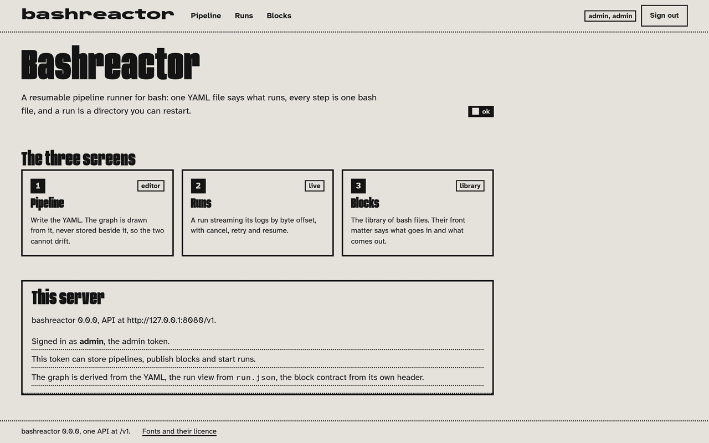
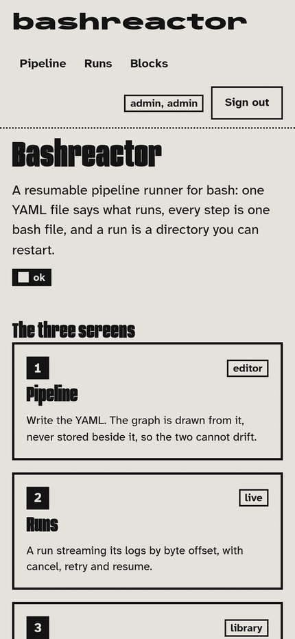
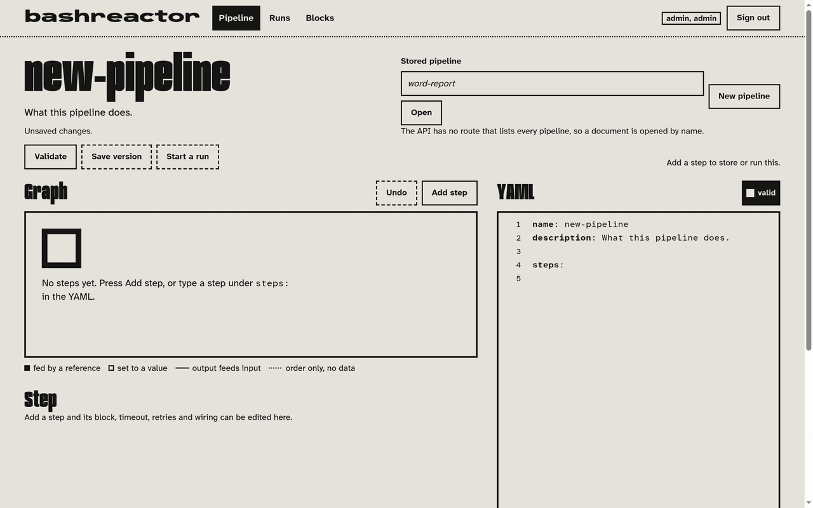
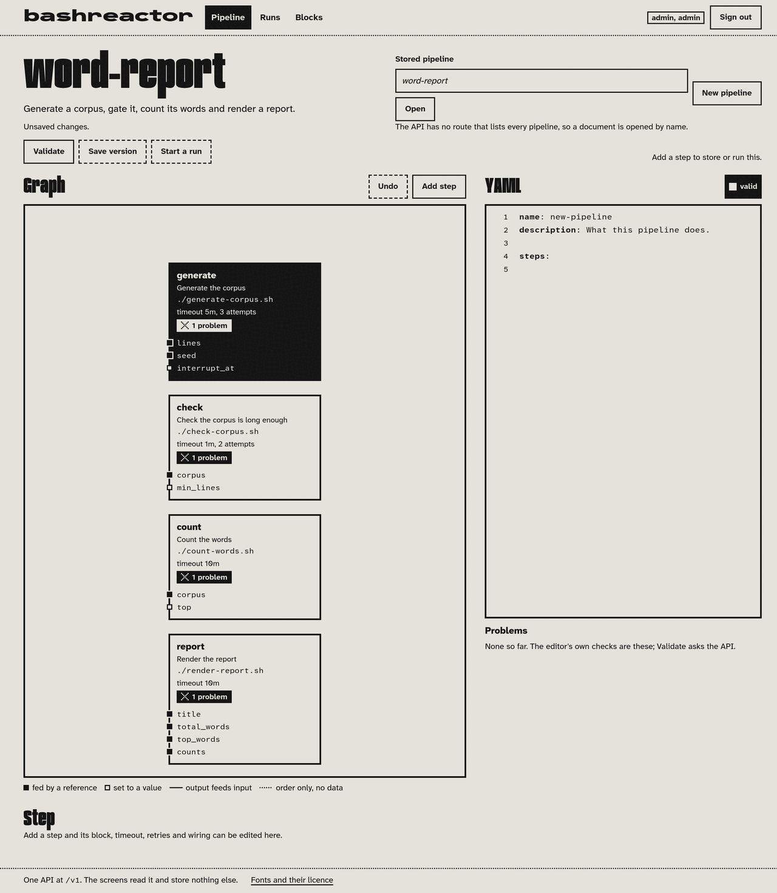
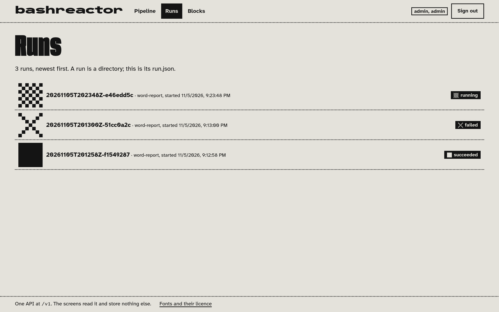
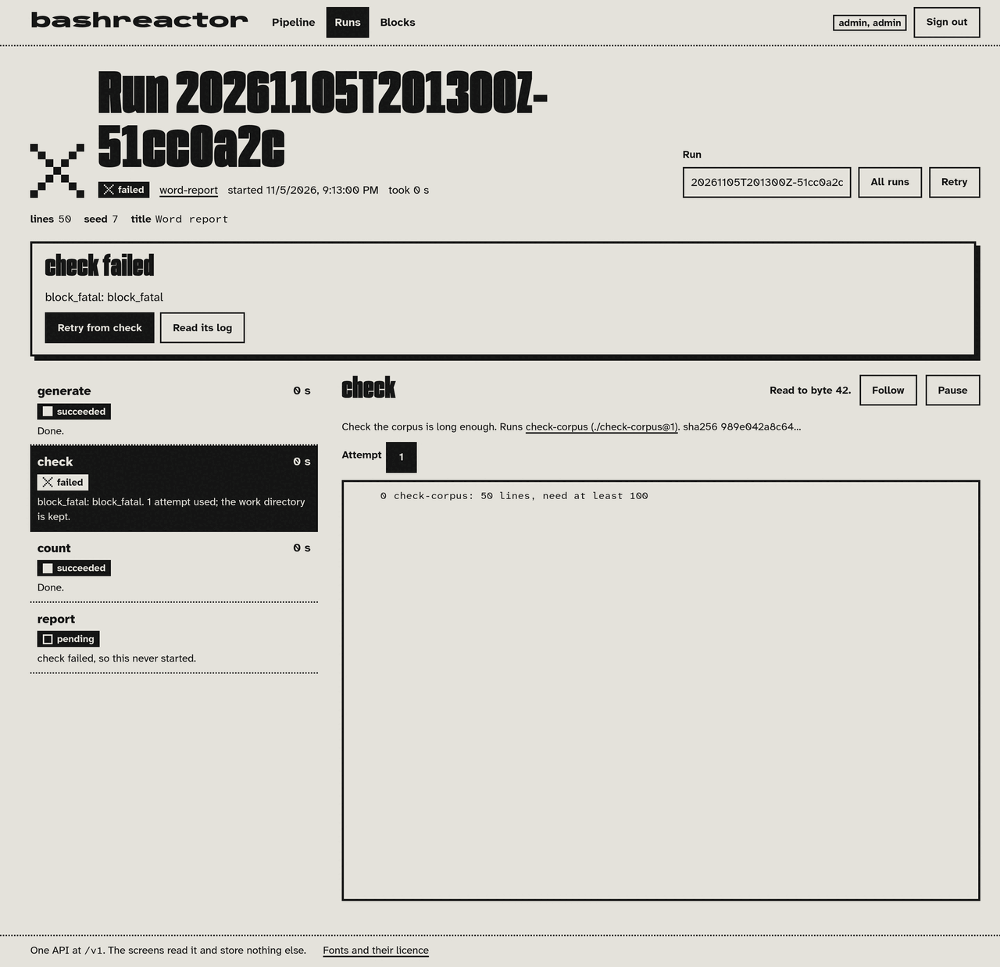

# Bashreactor

Run long bash jobs as pipelines of blocks, and drive them from the CLI, the web or an agent.

A **block** is a bash file that declares its inputs and outputs. A **pipeline** is a YAML file that
wires blocks together: step dependencies, outputs feeding inputs, retries and timeouts. Shaped like
GitHub Actions workflows, but for jobs that run for hours.

Status: being built. The spec is in [`docs/SPEC.md`](docs/SPEC.md).

## What it is

Bashreactor takes a job that runs for hours and breaks it into a graph of smaller ones. Each step is
one bash script with a header saying what it reads and what it produces, so the wiring can be checked
before anything runs and the contract can be read without reading the body. The pipeline file says
which steps depend on which, what each is given, how long it may take and how many attempts it gets.
Every step runs as its own process group, and a run lives in one directory on disk: `run.json`, a
snapshot of the pipeline and the blocks it used, and a work directory per step. That is what makes a
run restartable. If the engine dies, or a deploy replaces the pod under it, the next server reads that
directory and carries on: a step that succeeded is never run again, and a step that was cut off starts
again in the same work directory, on top of the output it already wrote. Everything goes over one HTTP
API at `/v1`, and the CLI, the web UI and the MCP server are all clients of it, with the same token and
the same scopes.

## What it looks like

Every screenshot here is the same pipeline:
[`docs/examples/word-report.yaml`](docs/examples/word-report.yaml), run against a local server by
[`examples/demo.sh`](examples/demo.sh). That pipeline is the worked example
[`docs/SPEC.md`](docs/SPEC.md) section 7 is written against, and
[`docs/examples/README.md`](docs/examples/README.md) fixes what a correct run returns: a 163 byte
report, `total_words` 1300 at the default inputs, the same sha256 for every artifact on every run.
`examples/demo.sh` checks those numbers itself and `examples/demo.test.ts` runs it as part of
`bun run check`, so the figures on these screens are the ones the tests expect.

### The gate


`/app` opens on a form and nothing else: the API base, prefilled with the page's own origin, and a
token. The token goes out as `Authorization: Bearer` on every call. Leave *Keep me signed in on this
device* alone and it lives in that tab only; tick it and it stays in the browser. It can be the admin
token or an agent token from `POST /v1/tokens`, and the scope on that token decides what the screens
will let you do. The footer is the whole design in one line: one API at `/v1`, and the screens store
nothing else.

### The entry page



Once the token is in, the entry page says what this server is and what you may do on it: the version,
the API base, a health line reading `ok`, and whether this token can store pipelines, publish blocks
and start runs. Below that are the three screens, each with the line that says what it is for. The
graph in the Pipeline editor is drawn from the YAML and never stored beside it, so the two cannot
drift. Runs is where a run streams its logs by byte offset, with cancel, retry and resume. Blocks is
the library of bash files, whose front matter says what goes in and what comes out.

The same page at phone width (430 px). Everything above is on it too.



## The three screens

### Pipeline: write the YAML, run it



The editor holds one pipeline document and is the only place in the UI that writes YAML. A new
document starts with `name`, `description` and an empty `steps:`; the graph pane is empty until there
is a step, and it says so. The legend under the graph is the four kinds of edge a step can have: fed by
a reference, set to a value, output feeds input, and order only with no data flowing, which is what
`needs: [check]` on the example's `report` step means. The buttons are the routes: `Validate` is
`POST /v1/pipelines/validate`, `Save version` is `POST /v1/pipelines/:name/versions`, `Start a run` is
`POST /v1/runs`. Opening is by name, because the API has no route that lists every pipeline, and the
screen says that out loud instead of pretending otherwise.



Here the same editor holds `word-report`. Each step in the graph shows the block it uses
(`./generate-corpus.sh`), its timeout and attempt budget (`generate`: 5m, 3 attempts; `check`: 1m, 2
attempts) and the inputs it takes, and each row carries a problem count. The Problems panel is the
editor's own checks; `Validate` is what asks the API. The header reads
*Unsaved changes*, because what is in the pane is not a stored version yet. Moving the caret into a
step in the YAML selects it in the graph, and edits redraw the graph as you type.

### Runs: the list, then one run


`GET /v1/runs`, newest first: the run id, the pipeline it is a run of, when it started, and its status.
The subtitle is the promise: a run is a directory, and this list is its `run.json`.



The same list while a run is in flight, with the newest row reading `running`. There is no websocket
and no callback: the list is a snapshot of `GET /v1/runs` that you reload, and the run's own page is
the one that polls, re-reading `GET /v1/runs/:id` once a second (`POLL_MS` in
`apps/web/src/client/runs.ts`).

#### The run that worked


`word-report` at its default inputs (`lines` 200, `seed` 7, `title` Word report), finished in 1 s. The
step list is in declaration order with a duration and a status per step, and the note under `generate`
reads *Took 2 attempts*: that is exit 75 spending one retry, the first of the hard cases below. The
panel on the right is the selected step, `report`: which block it ran and the sha256 of the stored
bytes, a picker for which attempt's log to read, its outputs (`report` at
`steps/report/attempts/1/outputs/report`, `report_bytes` 163), and the log pane.

#### The run that did not


The same pipeline with `lines` 50. The corpus is below `min_lines`, so `check` exits 78 and the run is
`failed` after 0 s. The alarm box names the step and the code and offers *Retry from check* and *Read
its log*. Three rules are visible at once: `check` spent 1 of its 2 attempts, because exit 78 never
spends the rest; `report` never started, its note reading *check failed, so this never started*, which
is SPEC 4.4's `skipped`; and `count`, which needs nothing from `check`, succeeded and published its
outputs anyway. One thing to know before you read that row: the status stamp on it says `pending`, not
`skipped`. The word `skipped` is in `run.json` and in the note's wording, not in the stamp.


The failed run at phone width (430 px): below 980 px the step list and the log panel stack into one
column (`@media (max-width: 980px)` in `apps/web/src/client/style.css`).

#### Reading a log



The log pane holds one attempt of one step, and its cursor is a byte offset (SPEC 4.8). This pane has
*Read to byte 42*, which is all of `check` attempt 1: one line, `check-corpus: 50 lines, need at least
100`. *Follow* keeps asking for whatever is new after the offset it has, *Pause* stops asking. It is
the same cursor `bashreactor runs logs <id> check --offset 42` uses and the same one `get_run_log`
takes, which is what makes following a six hour run one small request per interval rather than a
re-read of everything. The note above the panel says the other half of why a failure is not a dead
end: `1 attempt used; the work directory is kept`.

### Blocks: the library


`GET /v1/blocks/:name`, with the version you are looking at and its size in bytes. The two tables are
the block's own front matter read out of the stored bytes: `corpus` (file, required) and `top`
(integer, default 5) going in; `total_words`, `top_words` and `counts` coming out. Under them is the
source with the header still attached, so the contract and the code that honours it are on one screen.
Like pipelines, a block is opened by name, and for the same reason.

## One run, four surfaces

One path, and each client does its own part of it. The CLI drives the scripted demo because it is the
only surface that takes a pipeline **file** off your disk: `pipelines validate` publishes each
`uses: ./x.sh` beside that file into the library and rewrites the reference to the `name@version` the
library answered with. Everything after that is the same handful of routes from whichever client you
like. The full version of this table, with the commands and their output, is in
[`examples/README.md`](examples/README.md).

| Step | CLI | API route | Web screen | MCP tool |
| --- | --- | --- | --- | --- |
| store the four blocks | `pipelines validate docs/examples/word-report.yaml` | `POST /v1/blocks/:name/versions` | Blocks | `store_block_version` |
| store the pipeline | `pipelines add word-report docs/examples/word-report.yaml` | `POST /v1/pipelines/:name/versions` | Pipeline, Save version | `store_pipeline_version` |
| start a run | `runs start docs/examples/word-report.yaml` | `POST /v1/runs` | Pipeline, Start a run | `start_run` |
| follow a log while it runs | `runs logs <id> generate --follow` | `GET /v1/runs/:id/logs/:step/:attempt?offset=` | Runs, the log pane | `get_run_log` |
| read the outputs | `runs get <id>` | `GET /v1/runs/:id` | Runs, the outputs list | `get_run` |
| cancel, retry, resume | `runs cancel\|retry\|resume <id>` | the three `POST`s under `/v1/runs/:id` | the run's buttons | `cancel_run`, `retry_run`, `resume_run` |

`POST /v1/runs` answers 201 as soon as the run exists and the engine drives it in the background, so a
six hour block never becomes a six hour request. The MCP server is a front for the API and nothing
else: same token, same scopes, same error object, and a read token gets the API's own `forbidden`
answer from a write tool.

## The hard cases, on screen

Three things the spec promises about failure. All three come out of the same four blocks, none of them
staged with a fake step.

**Exit 75 spends a retry and resumes from the work directory** (SPEC 2.8, 4.1). `generate` is given
`interrupt_at: 120` and asked for 200 lines, so attempt 1 writes 120 lines into
`steps/generate/work/` and exits 75, `EX_TEMPFAIL`, which the spec reads as *retry me*. Attempt 2 runs
the same script in the same directory, finds 120 lines already written and finishes the corpus. On
screen that is `04`: `generate` succeeded, note *Took 2 attempts*. The logs are the rest of the story,
and they are one command each:

```bash
bashreactor runs logs <id> generate --attempt 1
bashreactor runs logs <id> generate --attempt 2
```

```
attempt 1: 0 of 200 lines already written
attempt 1: stopping after 120 lines, asking for a retry
attempt 2: 120 of 200 lines already written
attempt 2: corpus finished
```

Attempt 1's outputs directory is empty: a failed attempt's files are kept for debugging and never
published (SPEC 2.5).

**Exit 78 never spends the retry budget** (SPEC 2.8). That is `05`. `check` exits 78, which means *do
not bother*: another attempt would read the same short corpus. Its `retry` says `max_attempts: 2` and
the run spent one of them, which is the screen's `1 attempt used`.

**A skipped step does not stop unrelated work** (SPEC 4.4). Also `05`. `report` depends on `check`, so
it never starts and has no attempts and no bound inputs. `count` needs nothing from `check`, so it ran,
succeeded and published `total_words`, `top_words` and `counts` regardless. Failure takes down what
depended on it and leaves everything else alone.

## Try it

Two terminals. The first starts one process that serves the UI at `/app` and the API at `/v1`, which is
what the container runs, on a throwaway data directory under `/tmp` and with a token that is good for
nothing but your own machine.

```bash
bun install
./examples/serve.sh
```

The second runs the whole path and checks every number against `docs/examples/README.md`, printing
`ok` or `MISMATCH` per assertion:

```bash
export BASHREACTOR_URL=http://127.0.0.1:8080
export BASHREACTOR_TOKEN=br_demo_admin
./examples/demo.sh
```

Then open <http://127.0.0.1:8080/app> and look at what you just ran. `examples/api-demo.sh` walks the
same path over `curl` and `jq`, `examples/mcp-demo.sh` over the MCP tools, and
[`examples/README.md`](examples/README.md) is the long version of all of it, troubleshooting included.

## Layout

| Path | What |
| --- | --- |
| `docs/SPEC.md` | The block format and the pipeline YAML schema. Everything else follows it. |
| `docs/examples/` | The worked example pipeline the tests run against. |
| `docs/screenshots/` | The screenshots above, taken from a real run of `examples/demo.sh`. |
| `packages/core/` | Block + pipeline types and the parser, shared by everything. |
| `packages/store/` | Pipelines, runs, block versions, artifacts. |
| `apps/engine/` | The run engine: scheduling, state, logs, resume/cancel/retry. |
| `apps/api/` | REST API with token auth. |
| `apps/mcp/` | MCP server for agents. |
| `apps/cli/` | `bashreactor` CLI, local and remote mode. |
| `apps/web/` | Web UI: pipeline editor, live run view, block library. |
| `mockup/` | Static UI mockup, no build step. |

## One command

```bash
bun install
bun run check     # lint + typecheck + test
bun run test      # the tests alone
bun run build     # bundle the server into dist/
```

## Deploy

Push to `main` builds the Dockerfile and pushes `sha-<commit>` to GHCR; the cluster picks it up at
`bashreactor.mansus.org`. A pull request pushes `pr-<number>-<commit>` and gets
`https://bashreactor-pr-<number>.mansus.org` until it closes. See
[`.github/workflows/deploy.yml`](.github/workflows/deploy.yml).

The image listens on `PORT` (default 8080) and answers `GET /healthz` with 200 and the version it was
tagged with. One process serves the UI at `/app` and the API at `/v1`, which is why the demo and the
container start the same entry point: `apps/web/src/server.ts`. With no admin token set on the server,
`/healthz` still answers and every `/v1` route returns 503 `runtime_missing` naming the variable it
wants (SPEC 1.5).
