# Bashreactor

Run long bash jobs as pipelines of blocks, and drive them from the CLI, the web or an agent.

A **block** is a bash file that declares its inputs and outputs. A **pipeline** is a YAML file that
wires blocks together: step dependencies, outputs feeding inputs, retries and timeouts. Shaped like
GitHub Actions workflows, but for jobs that run for hours.

It runs at <https://bashreactor.mansus.org>: `/app` is the UI, `/v1` the API, `/healthz` the version
that is up. The spec is in [`docs/SPEC.md`](docs/SPEC.md). To run it yourself, `bun install` and
`./examples/serve.sh` from a checkout — two commands, in [`Try it`](#try-it) below — and the container
in [`Deploy`](#deploy) starts the same entry point.

## What it is

Bashreactor takes a job that runs for hours and breaks it into a graph of smaller ones. Each step is
one bash script with a header saying what it reads and what it produces, so the wiring can be checked
before anything runs and the contract can be read without reading the body. The pipeline file says
which steps depend on which, what each is given, how long it may take and how many attempts it gets.
Every step runs as its own process group, and a run lives in one directory on disk: `run.json`, a
snapshot of the pipeline and the blocks it used, and a work directory per step. That is what makes a
run restartable. If the engine dies, or a deploy replaces the pod under it, the next server reads that
directory and carries on. A step that succeeded is never run again. A step that was cut off starts
again from the top, in the same work directory, and only what it saved there carries over, because
every attempt gets a fresh, empty outputs directory (SPEC 2.5, 4.1). Everything goes over one HTTP API
at `/v1`, and the CLI, the web UI and the MCP server are all clients of it, with the same token and the
same scopes.

## What it looks like

These are screenshots of the web UI, taken in Chromium against a local server running this repo at
1440 × 900 and 390 × 844. The data is `apps/web/scripts/seed.ts`: the worked example
[`docs/examples/word-report.yaml`](docs/examples/word-report.yaml), the pipeline
[`docs/SPEC.md`](docs/SPEC.md) section 7 is written against, plus the small pipelines the seed adds so
the lists have every state a screen has to draw. It starts the default run, a run with `lines` 50 that
fails, one whose `generate` step spends a retry, one cancelled half way, one waiting for its next
attempt and one still running, so a picture of a live screen is a picture of a real engine working.

### The gate


`/app` opens on a form: the server address, prefilled with the page's own origin, and a token. The
token goes out as `Authorization: Bearer` on every call. Leave *Keep me signed in on this device* alone
and it lives in that tab only; tick it and it stays in the browser. It can be the admin token or an
agent token from `POST /v1/tokens`, and the scope on that token decides what the screens will let you
do. Nothing else is kept on the device, apart from the list of block names you have opened on the
Blocks screen.

### Dashboard

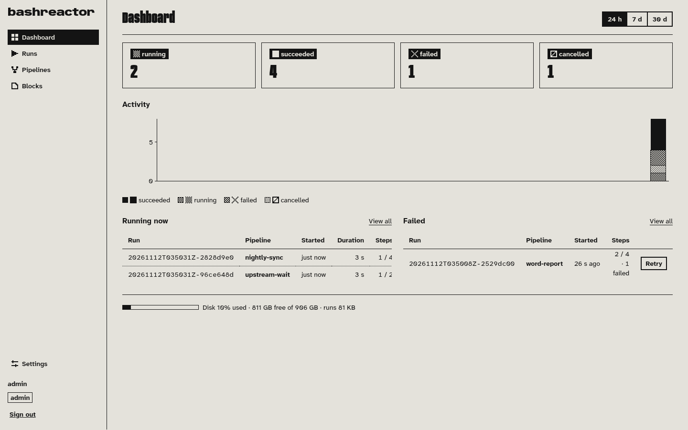

Once the token is in, `/app` is the Dashboard, which replaced the entry page that used to list the
screens. Four tiles count the window: running, succeeded, failed and cancelled, each a link to the
Runs list with that filter. Running counts every run that is going now, whatever its age; the other
three count runs created in the window. The window control says 24 h, 7 d or 30 d, and each is a local
calendar span — the current local hour or day plus the ones before it, not a rolling duration.

Activity is one stacked bar per hour or day, with failed, cancelled, running and succeeded stacked from
the baseline, and a legend that names all four states even when this window has none of one. Below it
are the two tables that need someone: Running now, which has no Status column because every row is
running, and Failed, with Retry on each row for a token that can write. Both stop at ten rows and link
to the filtered list. The disk meter at the bottom is the same disk the Settings screen shows, and the
alarm above it appears only when `GET /v1/disk` says `low`.

### Runs: the list, then one run

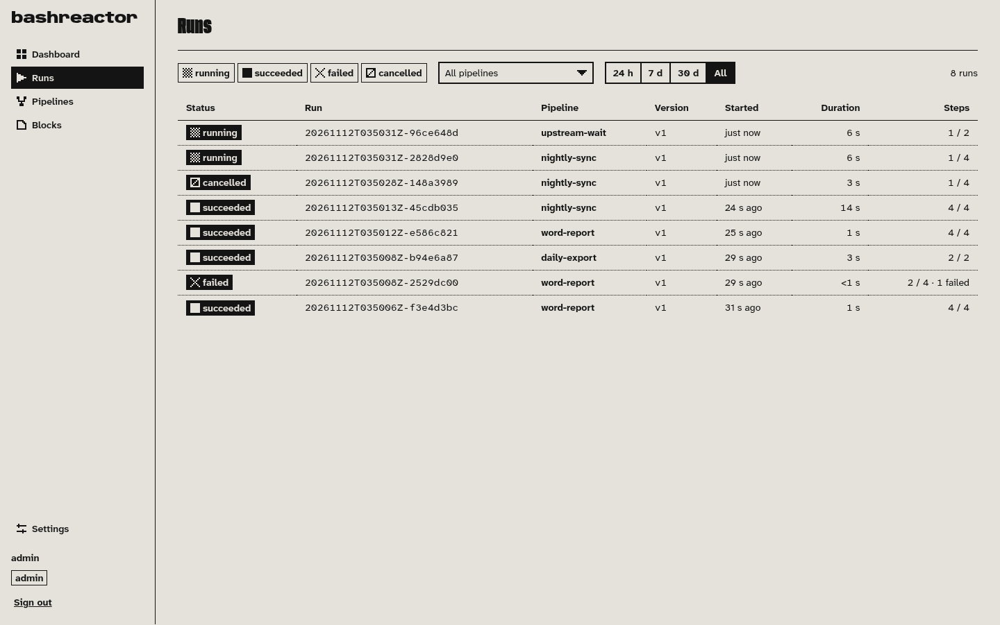

`GET /v1/runs`, newest first: the run id, the pipeline it is a run of, its version, when it started,
how long it took and how many steps succeeded. The filters — status, pipeline and window — live in the
address, so a reload, a bookmark and the back button all agree with what is on screen. The subtitle
states the design: a run is a directory, and this list is its `run.json`.

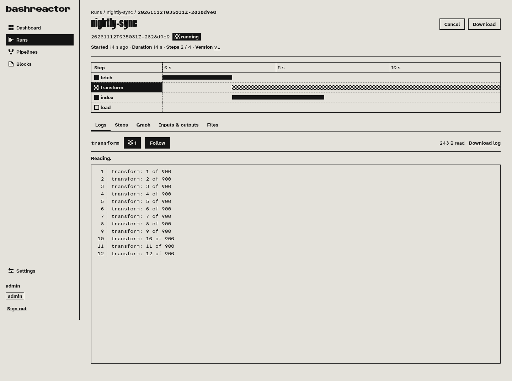

The same list leads to one run. This one is still going: its header says how long it has been running
and offers Cancel; the timeline puts every step on a common clock, with `transform` in its dither
because it is the running one; and the log pane is reading `transform` attempt 1, 243 bytes so far.
There is no websocket and no callback: both screens poll. The list re-reads `GET /v1/runs` once a
second while any run on it is `running`, and drops to one read every fifteen seconds (`IDLE_POLL_MS`)
once none is, because a run started from the CLI or in another tab has to turn up without a reload; a
run's own page re-reads `GET /v1/runs/:id` on the same beat (`POLL_MS` in
`apps/web/src/client/run-shared.ts`) until the run is final. Neither reads while the tab is in another
window, and both say so in the status line when a read fails rather than going quiet on you.

#### The run that worked

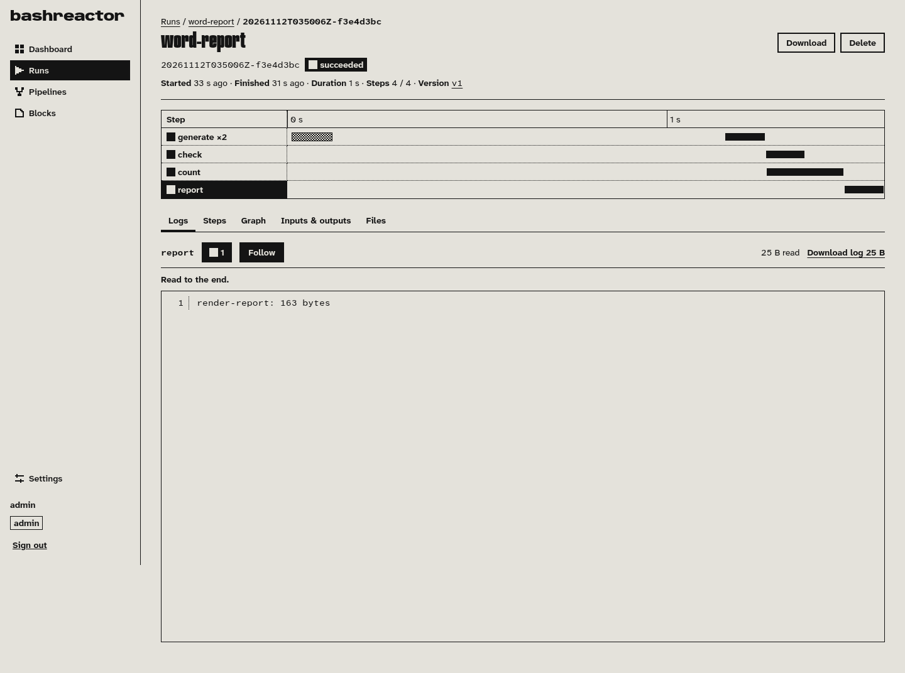

`word-report` at its default inputs (`lines` 200, `seed` 7, `title` Word report), finished in 1 s. The
meta line under the id reads Started, Finished, Duration, Steps and Version, with the exact instant on
each time. The timeline shows the four steps; `generate` needed two attempts, which is exit 75 spending
one retry, the first of the hard cases below. The tabs hold the log, the steps, the graph, the run's
inputs and outputs, and its files. The output `report` is 163 bytes, the same number
`examples/demo.sh` checks.

#### The run that did not

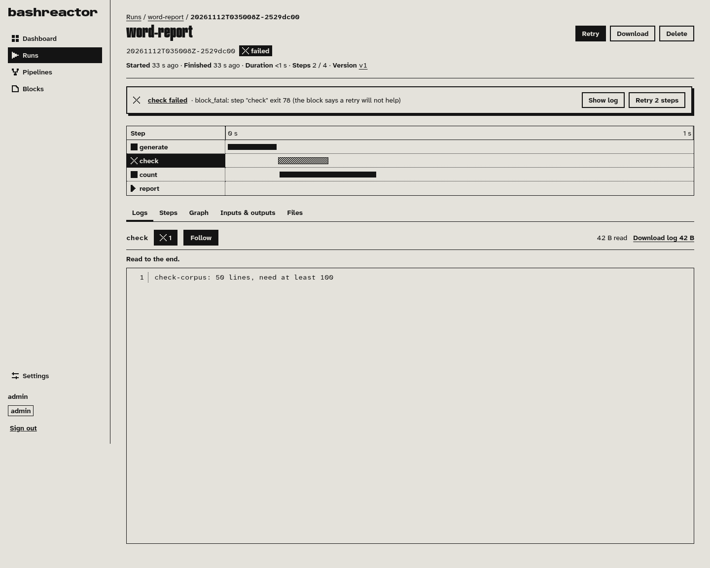

The same pipeline with `lines` 50. The corpus is below `min_lines`, so `check` exits 78 and the run is
`failed`. The alarm box names the step and the code and offers *Show log* and *Retry 2 steps*. On the
timeline, `count` is `succeeded` because it needs nothing from `check`, and `report` is `skipped`
because it does; the log pane has `check` attempt 1, 42 bytes, one line: `check-corpus: 50 lines, need
at least 100`. The run took less than a second, so its Duration says `<1 s` rather than rounding down to
a `0 s` that would look like no run at all.

#### Reading a log

The log pane holds one attempt of one step, and its cursor is a byte offset (SPEC 4.8). The pane asks
for whatever comes after its offset on every poll, and *Pause* stops it asking. *Follow* is about
keeping up rather than about fetching: it holds the pane at the newest line and moves it to a step's
newest attempt, and when the step you are watching ends while the run goes on, it moves the pane to the
step that is running now — watch `one` in a pipeline of `one` and a dependent `two`, and the pane goes
to `two` the moment `one` succeeds. Turn it off to pin the pane to one step. Because the cursor is an
offset, an answer only carries what is new, and the page only goes forward: it starts over from byte 0
when you point the pane at another step or attempt, and otherwise never does. A poll is one `run.json`
request and at least one log request, and each answer is capped at 1 MiB (`MAX_LOG_TEXT_BYTES` in
`apps/api/src/app.ts`), so the page asks again in the same poll while the server says there is more.
What keeps a six-hour run cheap to watch is the server side of that: `readLog` opens the log and reads
only the window it was asked for, through `readFileRange` in `apps/engine/src/run-store.ts`, whatever
the offset. On this side the pane keeps every line it has read and paints the last 2000 of them
(`MAX_DRAWN_LINES` in `apps/web/src/client/logs.ts`), with a note saying how many are not drawn. The
CLI's `bashreactor runs logs <id> check --offset 42` and the `get_run_log` tool use the same cursor.

### Pipelines: the stored documents

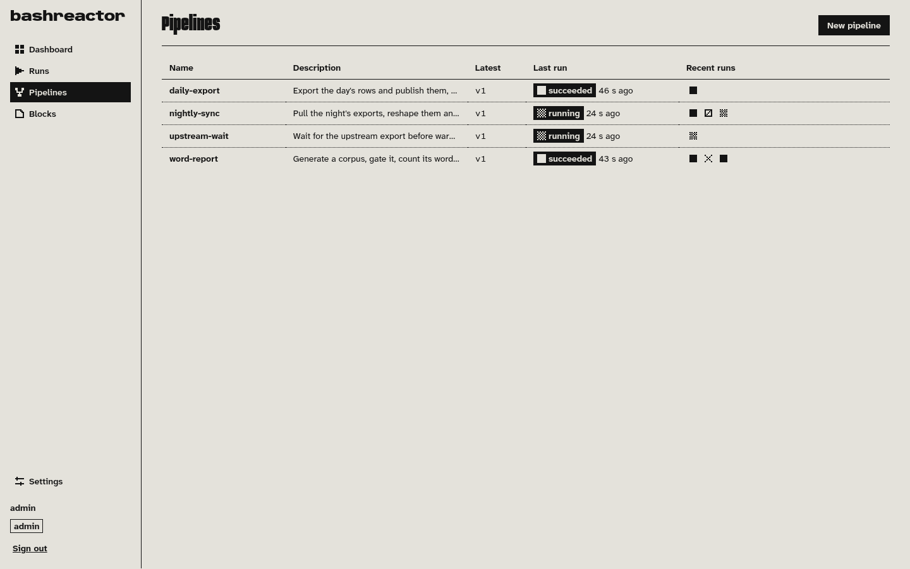

`GET /v1/pipelines` is the library of stored documents. Each row names the pipeline and reads its
latest version's description and its recent runs beside the row, four pipelines at a time, so one slow
pipeline cannot hold up the other nineteen. *New pipeline* opens the editor on a blank document, and a
row opens the pipeline itself.

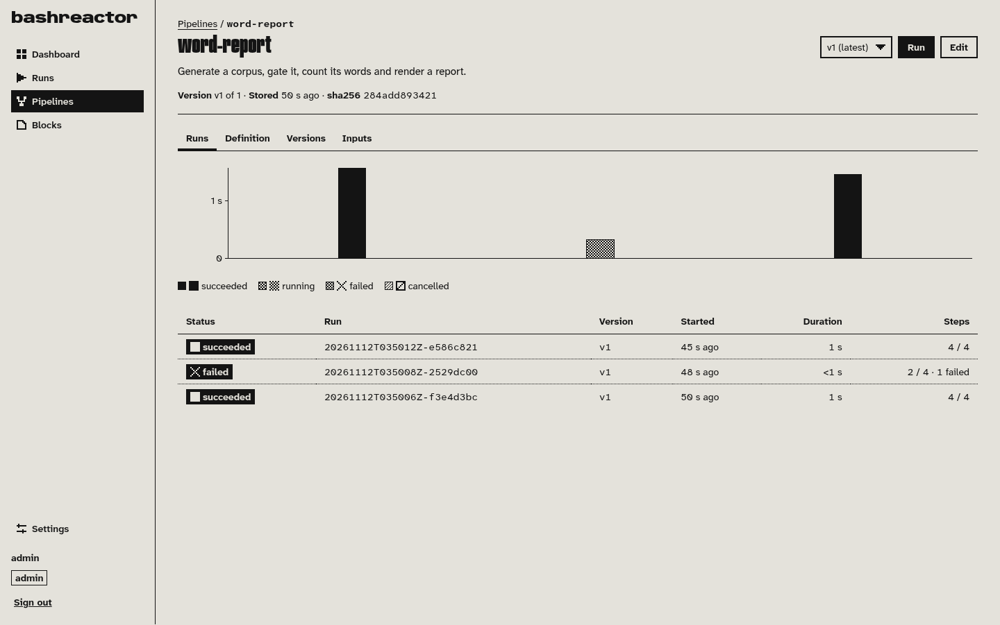

One pipeline has a header with its description, stored time and short hash, a version picker, and the
four things you can look at. Runs is a duration chart over its last thirty runs and the shared runs
table under it; Definition is the stored YAML beside the same graph the editor draws; Versions lists
every stored version; Inputs is the contract the pipeline declares. A version is in the address, so a
link can point at exactly the document you meant.

### The editor: write the YAML, run it

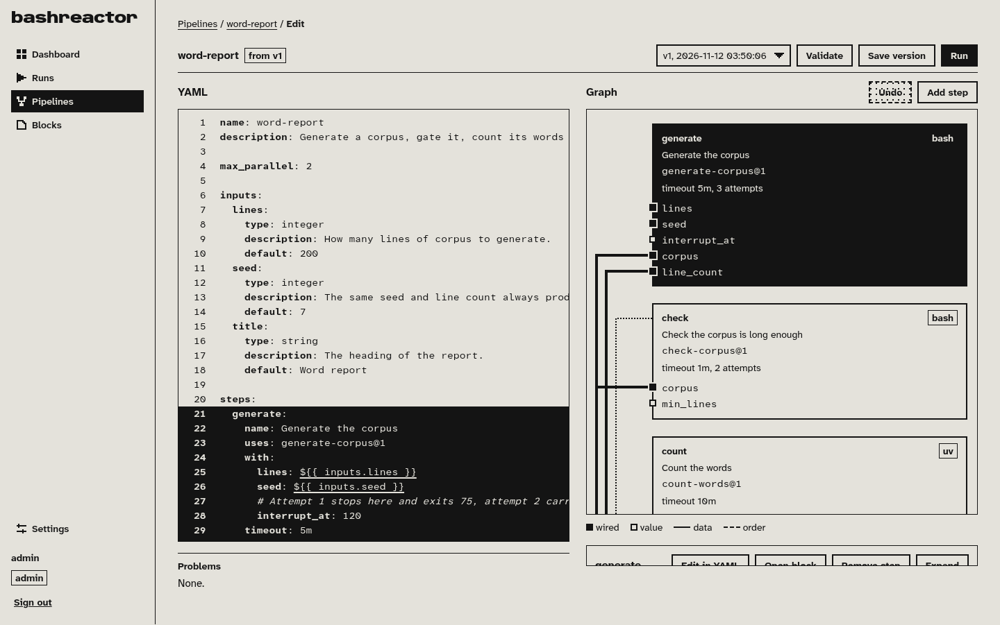

The editor holds one pipeline document, and it is the only place in the UI that writes YAML. YAML is on
the left with line numbers and a Problems panel under it; the graph is on the right, with the step
inspector folded to a header until you expand it. The legend under the graph says how the drawing
reads: an output feeding an input is a wire, a `needs:` entry is a wire with no data on it, and an
input port fed by a reference is marked differently from one set to a literal value. Click a step in
the graph and its block, timeout, attempts and wiring can be edited there, or the caret can follow you
through the YAML; moving it into a step selects the node.

The Problems panel is one list with two sources: the editor's own checks, run in the browser on every
keystroke against the block contracts it has fetched from the library, and the issues the API answered
with the last time you pressed `Validate`. Nothing goes to `POST /v1/pipelines/validate` until you
press that button, and the API is what refuses to store a pipeline it cannot resolve. The buttons are
the routes: `Validate` is `POST /v1/pipelines/validate`, `Save version` is
`POST /v1/pipelines/:name/versions`, `Run` opens the inputs dialog and is `POST /v1/runs`.

To see a stored pipeline as the library holds it, use the CLI: `bun apps/cli/src/bin.ts pipelines get
word-report` prints the document back with `uses: generate-corpus@1` where the file on disk says
`uses: ./generate-corpus.sh`. The CLI publishes each block beside the file and rewrites the reference,
which is the first row of the table below.

### Blocks: the library

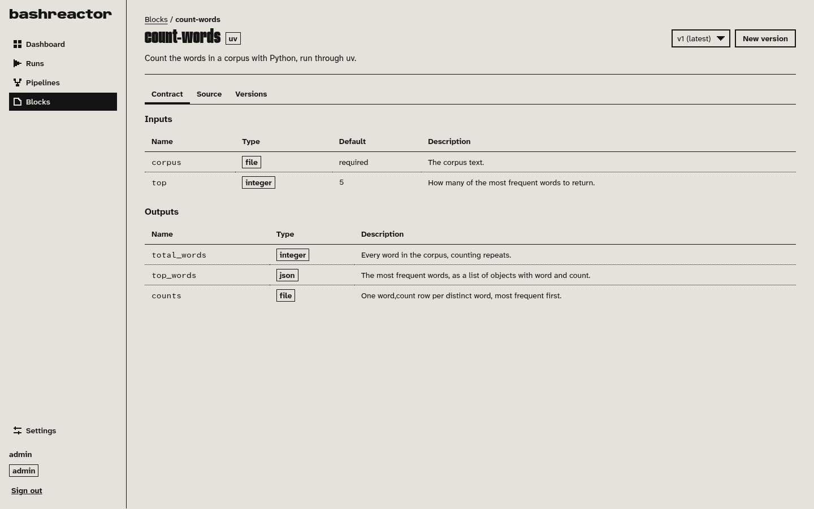

`GET /v1/blocks/:name`, with the version you are looking at and its size in bytes. The contract tab has
the two tables that are the block's own front matter read out of the stored bytes: `corpus` (file,
required) and `top` (integer, default 5) going in; `total_words`, `top_words` and `counts` coming out.
The source tab is the file with its header still attached, so the contract and the code that honours it
are on one screen, and the versions tab lists everything the library has stored for the name. Like
pipelines, a block is opened by name, and for the same reason.

### On a phone

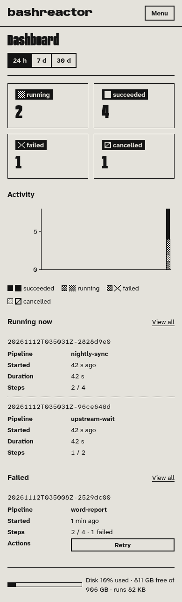

At 390 px the sidebar becomes a top bar, the counts go two by two, and every table becomes one block
per row: the first cell on top, then a label and value for each remaining cell. Nothing scrolls
sideways. The Dashboard is the same information as at desktop width, read down the page instead of
across it.

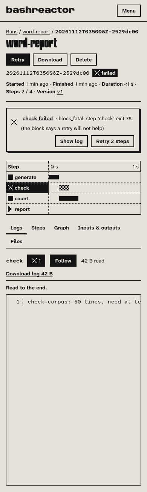

A run at the same width. The header, the alarm and the log stay one column, and the timeline keeps its
own scroll rather than widening the page. The design targets a 1280 to 1440 px desktop; the phone is
the same screen, not a second one.

## One run, four surfaces

One path, and each client does its own part of it. The CLI drives the scripted demo because it is the
only surface that takes a pipeline **file** off your disk: `pipelines validate` publishes each
`uses: ./x.sh` beside that file into the library and rewrites the reference to the `name@version` the
library answered with. Everything after that is the same handful of routes from whichever client you
like. In this repo the CLI is `bun apps/cli/src/bin.ts`; `examples/README.md` suggests
`alias bashreactor='bun apps/cli/src/bin.ts'`, and the commands below assume that alias. The full
version of this table, with the commands and their output, is in [`examples/README.md`](examples/README.md).

| Step | CLI | API route | Web screen | MCP tool |
| --- | --- | --- | --- | --- |
| store the four blocks | `pipelines validate docs/examples/word-report.yaml` | `POST /v1/blocks/:name/versions` | Blocks | `store_block_version` |
| store the pipeline | `pipelines add word-report docs/examples/word-report.yaml` | `POST /v1/pipelines/:name/versions` | Pipeline, Save version | `store_pipeline_version` |
| start a run | `runs start docs/examples/word-report.yaml` | `POST /v1/runs` | Pipeline, Start a run | `start_run` |
| follow a log while it runs | `runs logs <id> generate --follow` | `GET /v1/runs/:id/logs/:step/:attempt?offset=` | Runs, the log pane | `get_run_log` |
| read the outputs | `runs get <id>` | `GET /v1/runs/:id` | Runs, the outputs list | `get_run` |
| cancel, retry, resume | `runs cancel\|retry\|resume <id>` | the three `POST`s under `/v1/runs/:id` | the run's buttons | `cancel_run`, `retry_run`, `resume_run` |

`POST /v1/runs` answers 201 as soon as the run exists and the engine drives it in the background, so a
six-hour block never becomes a six-hour request. The MCP server is a front for the API and nothing
else: same token, same scopes, same error object. Call a write tool with a read token and it is refused
before anything is sent, with the API's `forbidden` code and the MCP server's own sentence naming the
tool (`refusalFor` in `apps/mcp/src/tools.ts`).

## The hard cases, on screen

Three things the spec promises about failure, all three from the same four blocks. The first is
provoked on purpose: `interrupt_at: 120` is in the example so that a real attempt stops in the middle
of real work, and nothing about the retry is faked.

**Exit 75 spends a retry and resumes from the work directory** (SPEC 2.8, 4.1). `generate` is given
`interrupt_at: 120` and asked for 200 lines, so attempt 1 writes 120 lines into
`steps/generate/work/` and exits 75, `EX_TEMPFAIL`, which the spec reads as *retry me*. Attempt 2 runs
the same script from the top, in the same work directory, finds 120 lines already written and finishes
the corpus. On screen that is the run that worked: `generate` succeeded, note *Took 2 attempts*. The
logs are the rest of the story, one command each, shown here without the `next offset` lines the CLI
prints after each log:

```bash
bashreactor runs logs <id> generate --attempt 1
bashreactor runs logs <id> generate --attempt 2
```

```
attempt 1: 0 of 200 lines already written
attempt 1: stopping after 120 lines, asking for a retry
attempt 2: 120 of 200 lines already written
attempt 2: corpus finished
```

Attempt 1's outputs directory is empty: a failed attempt's files are kept for debugging and never
published (SPEC 2.5).

**Exit 78 never spends the retry budget** (SPEC 2.8). That is the run that did not. `check` exits 78,
which means *do not bother*: another attempt would read the same short corpus. The pipeline gives it
`max_attempts: 2` and the run spent one.

**A skipped step does not stop unrelated work** (SPEC 4.4). Also the run that did not. `report` depends
on `check`, so it never starts, with no attempts and no bound inputs; on the run screen that is a row
stamped `skipped`, its note naming `check`. `count` needs nothing from `check`, so it ran and published
`total_words`, `top_words` and `counts` regardless; read them in `run.json` or with
`bashreactor runs get <id>`. Failure takes down what depended on it and leaves everything else alone.

## Try it

You need `bun`, `uv`, `bash` 5, `curl` and `jq`. The engine refuses to start unless they are on its
`PATH` (SPEC 2.6), and `count-words.sh` runs Python through `uv`.

Two terminals. The first starts one process that serves the UI at `/app` and the API at `/v1`, which is
what the container runs. Its data directory is `$BASHREACTOR_HOME`, default `/tmp/bashreactor-demo`,
and it outlives the server, so a second demo adds runs to the first lot; export your own
`BASHREACTOR_HOME` if you want a clean list.

```bash
bun install
./examples/serve.sh
```

The second runs the whole path and checks every number against `docs/examples/README.md`, printing
`ok` or `MISMATCH` per assertion:

```bash
export BASHREACTOR_URL=http://127.0.0.1:8080
export BASHREACTOR_TOKEN=br_demo_admin
alias bashreactor='bun apps/cli/src/bin.ts'
./examples/demo.sh
```

Then open <http://127.0.0.1:8080/app> and look at what you just ran. `examples/api-demo.sh` walks the
same path over `curl` and `jq`. `examples/mcp-demo.sh` calls the MCP read tools against the runs those
two made, so it runs after them and starts no run of its own.
[`examples/README.md`](examples/README.md) is the long version of all of it, troubleshooting included.

## Layout

| Path | What |
| --- | --- |
| `docs/SPEC.md` | The block format and the pipeline YAML schema. Everything else follows it. |
| `docs/examples/` | The worked example pipeline the tests run against. |
| `docs/screenshots/` | The screenshots above, taken from runs of the worked example. |
| `packages/core/` | Block + pipeline types and the parser, shared by everything. |
| `packages/store/` | Pipelines, runs, block versions, artifacts. |
| `apps/engine/` | The run engine: scheduling, state, logs, resume/cancel/retry. |
| `apps/api/` | REST API with token auth. |
| `apps/mcp/` | MCP server for agents. |
| `apps/cli/` | `bashreactor` CLI: a client of the API over HTTP with a bearer token. |
| `apps/web/` | Web UI: pipeline editor, live run view, block library. |

## One command

```bash
bun install
bun run check     # lint + typecheck + test
bun run test      # the tests alone
bun run build     # bundle the server into dist/
```

## Deploy

A push to `main` deploys once its `ci` run has passed: the Dockerfile is built and `sha-<commit>` is
pushed to GHCR, and the cluster picks it up at `bashreactor.mansus.org`. A push whose `ci` fails is
never built, and when two runs finish out of order only the commit `main` points at goes out, so
production never moves backwards. A pull request pushes `pr-<number>-<commit>` and gets
`https://bashreactor-pr-<number>.mansus.org` until it closes. See
[`.github/workflows/deploy.yml`](.github/workflows/deploy.yml).

The image listens on `PORT` (default 8080) and answers `GET /healthz` with 200 and the version it was
tagged with. One process serves the UI at `/app` and the API at `/v1`, which is why the demo and the
container start the same entry point: `apps/web/src/server.ts`. With no admin token set on the server,
`/healthz` still answers and every `/v1` route returns 503 `runtime_missing` naming the variable it
wants (`authenticate` in `apps/api/src/auth.ts`).
